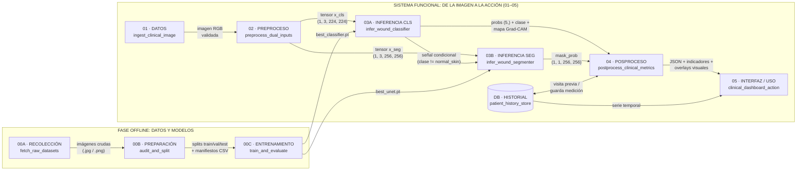

# Pipeline del Sistema — `skin-wound-tracker`

Diseño bloque por bloque siguiendo el estándar UAO (*De la imagen a la acción* y *Anatomía de un bloque*: Nombre, Función, Entrada, Salida).  
**Regla de alcance actual:** el sistema y los datasets operan exclusivamente sobre **imágenes clínicas RGB** (sin textos ni formularios de metadatos externos).

---

## 1. Diagrama del Pipeline

---

## 2. Anatomía de Bloques (Nombre · Función · Entrada · Salida)

| Bloque (Diagrama / Código) | Función (en una frase) | Entrada | Salida |
| :--- | :--- | :--- | :--- |
| **`01 · DATOS`** `ingest_clinical_image()` | Carga y valida la fotografía clínica RGB antes de procesarla. | Archivo `.jpg`/`.png` RGB desde cámara o repositorio. | `PIL.Image` RGB validada ($\ge 64\times64$, EXIF corregido) + `orig_size (H, W)`. |
| **`02 · PREPROCESO`** `preprocess_dual_inputs()` | Redimensiona y normaliza la imagen a las dimensiones que espera cada modelo. | `PIL.Image` RGB desde `01 · DATOS`. | `x_cls` `FloatTensor (1, 3, 224, 224)` y `x_seg` `FloatTensor (1, 3, 256, 256)` (normalización ImageNet). |
| **`03A · INFERENCIA CLS`** `infer_wound_classifier()` | Clasifica la imagen en una de las 5 clases clínicas y genera el mapa de atención Grad-CAM. | `x_cls` (`02`) + pesos `best_classifier.pt`. | `pred_class`, `confidence`, `probs (5,)`, `gradcam_map (H, W)` y bandera `has_wound = (pred_class != "normal_skin")`. |
| **`03B · INFERENCIA SEG`** `infer_wound_segmenter()` | Segmenta píxel a píxel la región de la herida solo cuando existe lesión activa. | `x_seg` (`02`) + señal `has_wound == True` (`03A`) + pesos `best_unet.pt`. | `mask_prob` float32 `(256, 256)` en `[0, 1]` (o `None` si `normal_skin`). |
| **`04 · POSPROCESO`** `postprocess_clinical_metrics()` | Convierte predicciones y máscara en métricas de área, variación longitudinal y alertas clínicas. | Salidas de `03A`, `03B` y registro previo de `DB · HISTORIAL`. | `clinical_report.json` (`wound_area_px`, `wound_area_pct`, `delta_area_pct`, `triage_priority`, `clinical_alert`) + overlays (`contour`, `gradcam`). |
| **`DB · HISTORIAL`** `patient_history_store` | Persiste y consulta la serie temporal de mediciones de área para evaluar cicatrización. | Registro `clinical_report.json` desde `04 · POSPROCESO`. | Medición anterior hacia `04` y serie temporal hacia `05`. |
| **`05 · INTERFAZ / USO`** `clinical_dashboard_action()` | Muestra el diagnóstico visual explicable, la evolución temporal y dispara alertas operativas. | `clinical_report.json`, overlays (`04`) y serie temporal (`DB`). | Panel visual + ficha clínica descargable (`JSON`) + alerta de estancamiento o revisión humana. |

---

## 3. Cinco Preguntas Encadenadas (Resumen Ejecutivo)

1. **Entrada concreta:** Fotografía clínica RGB (`.jpg`/`.png`) desde cámara o archivo; se valida integridad, resolución $\ge 64\times64$, 3 canales y orientación EXIF.
2. **Procesamiento trazable:** `01 ingest` → `02 preprocess (224×224 + 256×256)` → `03A clasificador + Grad-CAM` → `03B segmentador U-Net` *(solo si hay herida)* → `04 posproceso ↔ DB historial` → `05 interfaz`.
3. **Predicción interpretable:** JSON con `pred_class` (5 etiologías), `confidence` y `probs`, `gradcam_map`, `mask_binary`, `wound_area_px/pct`, `delta_area_pct`, `triage_priority` y `clinical_alert`.
4. **Representación visible:** Tarjeta de diagnóstico + barras de probabilidad + mapa de calor Grad-CAM + foto con contorno verde y área + gráfica temporal de evolución + semáforo de alerta y descarga JSON.
5. **Acción o valor:** Reemplaza la evaluación subjetiva por planimetría automática; emite alerta de estancamiento si el área no reduce $\ge 20\%$ entre consultas y escala a revisión humana cuando `confidence < 0.70`.
